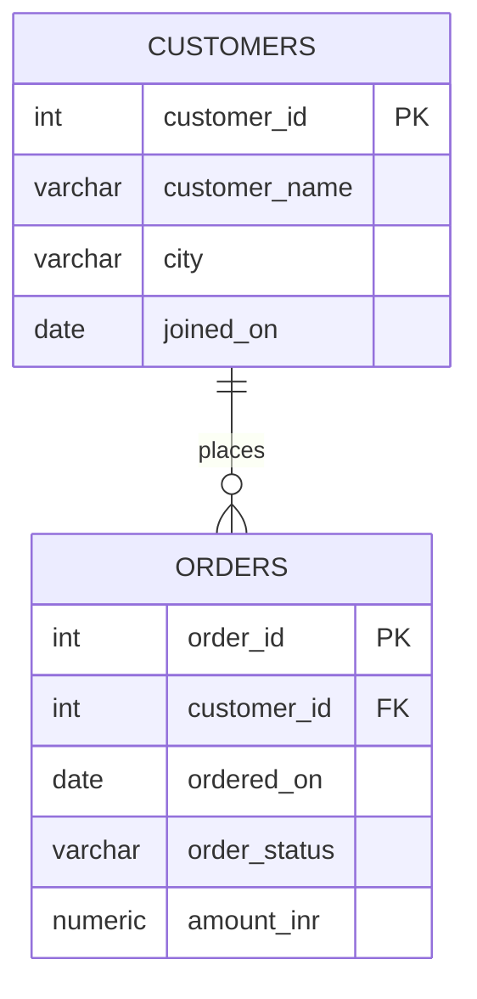

# RabTech Task 02 — ER Diagram

Paste the Mermaid block into a Mermaid-compatible Markdown viewer or Mermaid Live Editor to render it.

`CUSTOMERS ||--o{ ORDERS` means one customer can have zero or many orders, while every order belongs to exactly one customer.
